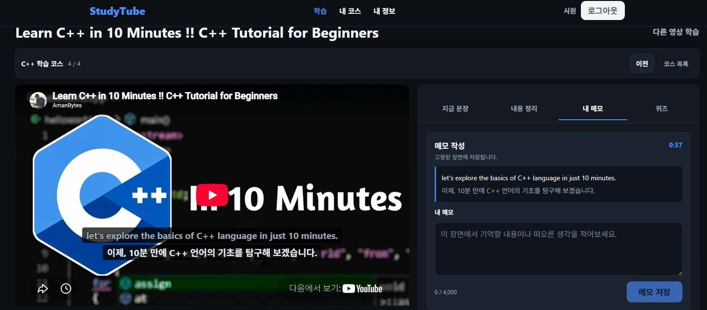
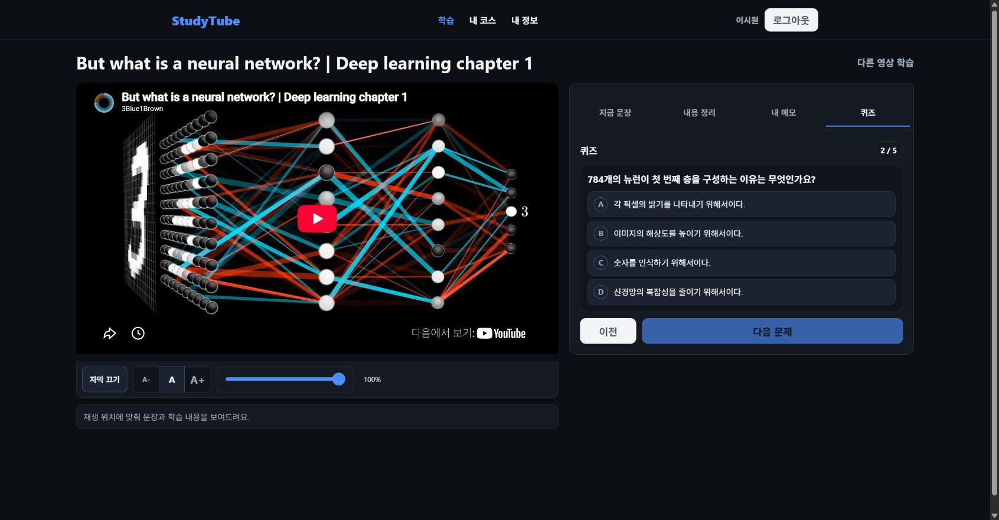
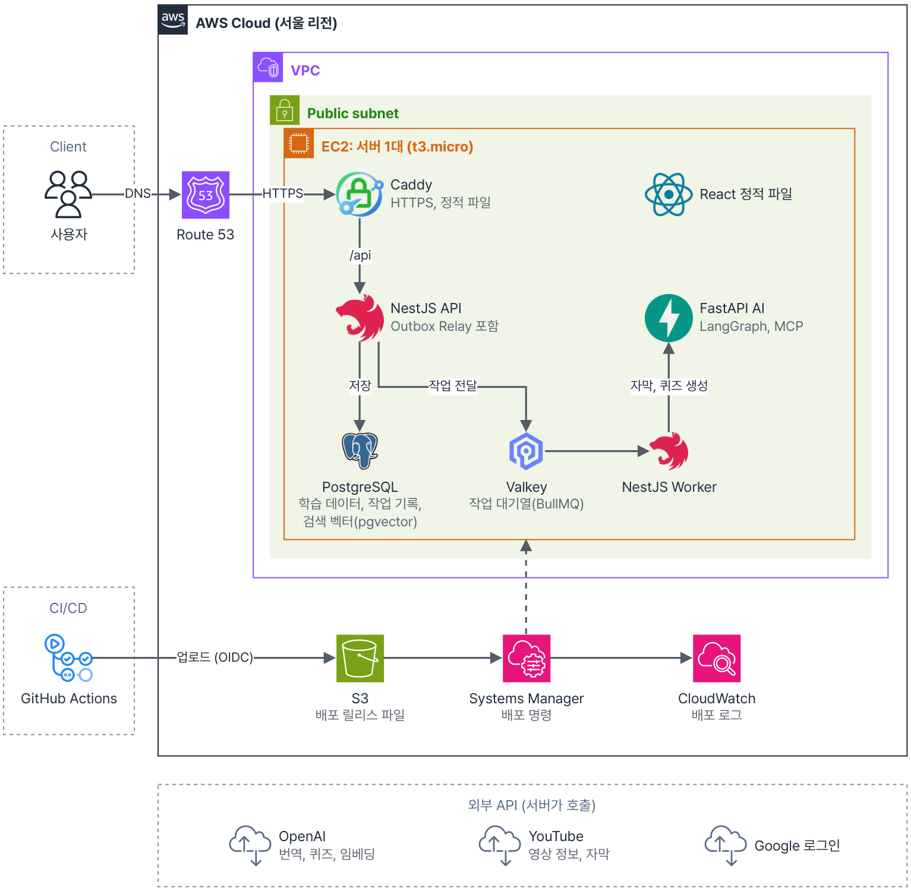

# StudyTube

외국어 YouTube 영상을 번역 자막과 함께 보고 메모와 퀴즈로 복습하는 개인 프로젝트입니다. 관심 분야와 학습 시간에 맞는 영상을 코스로 저장해 이어서 볼 수 있습니다.

[서비스 바로가기](https://studytube.page) | [평가 자료](.eval/README.md) | [CI/CD](https://github.com/NearthYou/Studytube/actions/workflows/ci-cd.yml) | [API 계약](api/openapi/current.json)

`TypeScript` `React` `NestJS` `Python / FastAPI` `PostgreSQL` `AWS EC2`



## 개발 배경

외국어 영상을 보다가 번역기와 메모 앱을 오가면 영상의 흐름을 놓칩니다. 메모를 남겨도 나중에 어느 장면의 내용인지 다시 찾기 어렵습니다.

YouTube에는 재생 위치가 남지만 모르는 문장과 메모, 틀린 문제까지 모아 볼 수는 없습니다. StudyTube는 이 기록을 재생 시점에 연결합니다. 메모나 오답에서 해당 장면으로 돌아갈 수 있고 다음에 볼 영상은 코스에 저장합니다.

## 사용 흐름

1. YouTube 영상 주소를 넣거나 배우고 싶은 내용을 적습니다.
2. 원문 자막이 준비되는 대로 영상을 보며 문장을 확인합니다.
3. 필요한 문장은 재생 시점과 함께 메모로 저장합니다.
4. 영상 전체 자막이 준비되면 내용을 확인하는 퀴즈를 풉니다.
5. 추천 영상을 코스로 저장하고 다음 학습을 이어 갑니다.



[코스 만들기](docs/demo/studytube-course-builder-live-20261021.png) | [코스 보관함](docs/demo/studytube-course-library-live-20261021.png)

## 기술 스택

| 용도 | 기술 |
| --- | --- |
| 학습 화면 | React, TypeScript, Vite |
| API와 Worker | NestJS, TypeScript |
| AI 처리 | Python, FastAPI, LangGraph, OpenAI API |
| 데이터와 검색 | PostgreSQL, pgvector, pg_trgm |
| 작업 대기열 | Valkey, BullMQ |
| 서버와 배포 | AWS EC2, Caddy, Docker, GitHub Actions, S3, Systems Manager |

## 주요 개선

### 원문 자막 우선 표시

처음에는 원문과 번역, 검색 데이터가 모두 준비돼야 학습 화면을 열었습니다. 긴 영상은 처리가 끝날 때까지 기다려야 했습니다.

세 작업의 준비 상태를 따로 관리해 원문부터 보여 주도록 바꿨습니다. 번역은 준비되는 대로 해당 문장에 붙입니다. 서로 다른 처리 회차의 결과가 섞이지 않도록 같은 회차에서 나온 결과만 합칩니다.

처리 순서와 상태 관리는 [자막 처리 구조](docs/architecture.md#영상-등록과-자막-처리)에서 확인할 수 있습니다.

### 영상 전체를 다루는 퀴즈

일부 자막만으로 퀴즈를 만들면 영상 뒤쪽 내용이 빠질 수 있었습니다. 화면과 API에서 자막이 영상의 시작부터 끝까지 준비됐는지 확인하도록 바꿨습니다. 전체 구간을 다섯 부분으로 나누고 각 구간에서 출제할 문장을 고릅니다.

FastAPI는 문제 초안을 만든 뒤 보기와 정답이 자막 내용에 맞는지 검사합니다. 출제에 쓴 자막 버전과 시점을 저장해 답을 확인한 뒤 해당 장면으로 돌아갈 수 있습니다.

[출제 구간 선택](api/src/learning/quiz-evidence-sampling.ts)과 [문제 생성 및 검수 코드](ai/quiz_generation_graph.py)에서 처리 과정을 확인할 수 있습니다.

### 작업 유실과 중복 실행 방지

DB에 저장한 뒤 큐에 작업을 넣기 전에 API가 꺼지면 작업이 사라질 수 있었습니다. 큐가 같은 작업을 다시 보내면 외부 처리가 중복될 수도 있었습니다.

학습 데이터 변경과 보낼 작업을 PostgreSQL의 같은 트랜잭션에 기록하도록 바꿨습니다. [작업 전달 코드](api/src/work/outbox-relay.service.ts)가 이 기록을 읽어 대기열로 보냅니다. Worker는 실행 상태를 주기적으로 갱신합니다. 완료한 작업이 다시 들어오면 저장된 결과를 반환합니다. 관련 조건은 [작업 전달 테스트](api/src/work/outbox-relay.service.spec.ts)에서 확인합니다.

## 평가 결과

퀴즈가 자막에 근거한 답을 묻는지 확인하고 학습 자료를 찾는 검색 방식을 비교했습니다. 퀴즈는 공개 강의 영상 27개로 평가했고 검색은 데모 게시글과 질문 10개로 평가했습니다.

[퀴즈 평가](.eval/README.md#퀴즈-생성)에서는 영상 27개 중 23개의 퀴즈가 첫 검사를 통과했습니다. 나머지 영상 4개에서 나온 7문제는 모델이 자막 근거 부족으로 판정했습니다. 해당 영상의 퀴즈를 한 번 다시 만들었고 그중 1개가 검사를 통과했습니다. 최종적으로 24개 영상의 퀴즈를 채택하고 3개 영상은 제외했습니다. 이 결과는 모델의 검수 기준이며 사람이 확인한 정답 정확도는 아닙니다.

[검색 평가](.eval/README.md#검색)는 질문마다 정답 자료를 미리 정하고 그 자료가 상위 3개 결과에 포함되는지를 비교했습니다.

| 검색 방식 | 정답 자료를 모두 찾은 질문 수 |
| --- | ---: |
| 키워드 검색 | 7 / 10 |
| 문장의 의미로 찾는 벡터 검색 | 9 / 10 |
| 두 방식을 합친 검색 | 9 / 10 |

영상별 문제와 판정 이유, 질문별 검색 순위, 집계를 확인하는 코드는 [평가 자료](.eval/README.md)에 있습니다. 평가 조건과 지표의 뜻도 함께 설명했습니다.

## 인프라 아키텍처

서울 리전의 Public Subnet에서 EC2 한 대(t3.micro)로 운영합니다. 비용을 줄이려고 모든 서비스를 같은 서버에 두고 부족한 메모리는 2GB 스왑으로 보완했습니다.



- Route 53이 도메인을 EC2 주소에 연결합니다. Caddy는 HTTPS와 React 정적 파일을 제공하고 `/api` 요청을 NestJS API로 전달합니다.
- NestJS API는 학습 데이터와 작업 기록을 PostgreSQL에 저장합니다. API 안의 Outbox Relay가 Valkey의 BullMQ 대기열로 작업을 전달합니다.
- Worker가 자막과 퀴즈처럼 오래 걸리는 작업을 맡고 Python AI 서버를 호출합니다. 검색에 쓸 벡터도 PostgreSQL에 저장합니다.
- 외부 요청은 Caddy만 받습니다. API와 AI, DB와 큐는 서버 내부에서 통신합니다. DB와 큐의 포트는 외부에 열지 않습니다.
- OpenAI는 번역과 퀴즈 생성, 임베딩을 처리합니다. 영상 정보와 자막은 YouTube에서 가져오고 로그인은 Google 계정을 사용합니다.
- GitHub Actions는 OIDC 임시 권한으로 배포 릴리스 파일을 S3에 올립니다. Systems Manager가 EC2에 배포 명령을 보내고 CloudWatch에 배포 로그를 남깁니다. 배포를 위해 SSH 포트를 열지 않습니다.

클래스 관계와 요청 흐름은 [아키텍처 문서](docs/architecture.md)에서 볼 수 있습니다.

## CI/CD

CI를 통과한 커밋으로 배포 파일을 만들고 OIDC와 SSM으로 배포합니다. AWS 장기 키와 SSH는 사용하지 않습니다.

검증 명령과 최근 실행 결과는 [검증 기록](docs/verification.md), 배포 흐름은 [CI/CD 문서](docs/ci-cd.md)에 있습니다.

## 로컬 실행

Node.js 24.8 이상, Python 3.12, Docker Compose v2가 필요합니다. AI 의존성까지 같은 조건으로 맞추려면 Linux 또는 WSL 환경을 권장합니다.

```bash
cp .env.example .env
cp api/.env.example api/.env
npm --prefix api ci
npm --prefix web ci
python3 -m venv ai/.venv
ai/.venv/bin/python -m pip install --require-hashes -r ai/requirements.txt
npm run db:up
npm run db:migrate:up
npm run all
```

- Web: `http://localhost:5173`
- API: `http://localhost:3000`
- AI: `http://localhost:8000`

세부 설정은 [개발 환경 문서](docs/environment-setup.md), API와 운영 명령은 [API README](api/README.md)와 [Operations README](operations/README.md)에 있습니다.
