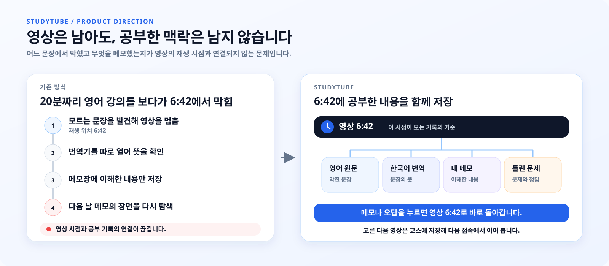
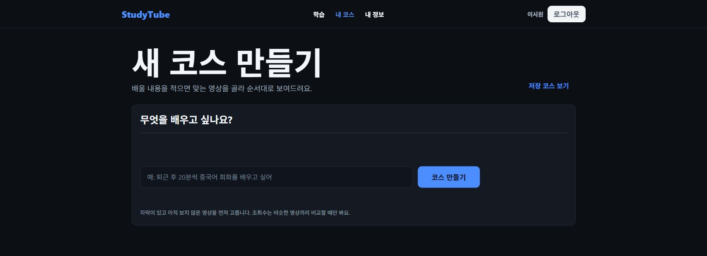
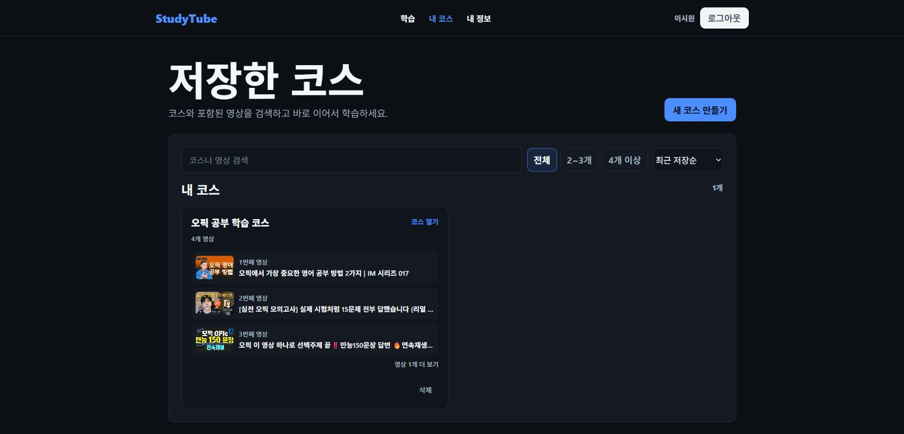
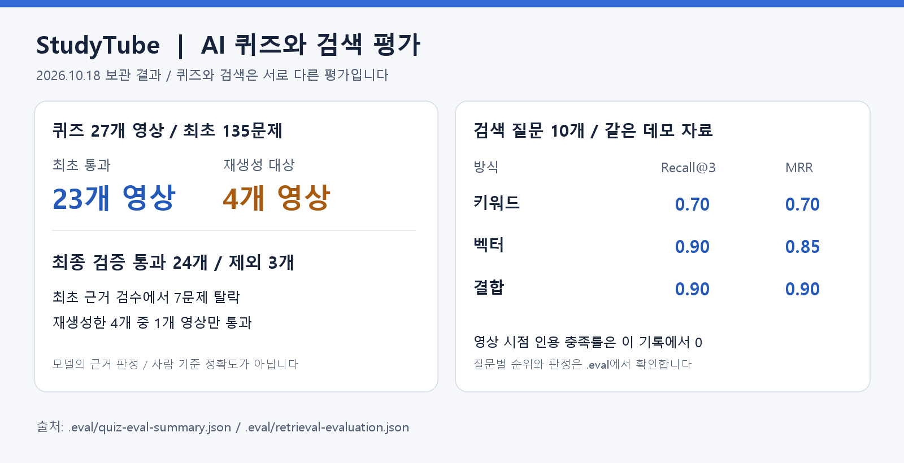
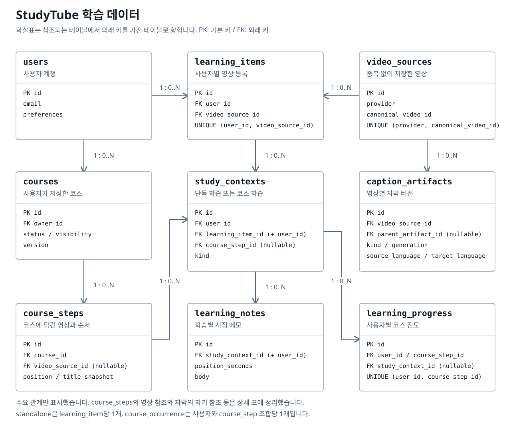

# StudyTube

외국어 YouTube 영상을 번역 자막과 함께 보고 메모와 퀴즈로 복습하는 개인 프로젝트입니다. 관심 분야와 학습 시간에 맞는 영상을 코스로 저장해 이어서 볼 수 있습니다.

[서비스 바로가기](https://studytube.page) | [CI/CD](https://github.com/NearthYou/Studytube/actions/workflows/ci-cd.yml) | [API 계약](api/openapi/current.json)

`TypeScript` `React` `NestJS` `Python / FastAPI` `PostgreSQL` `AWS EC2`


영상 아래에서 자막을 켜고 끄거나 글자 크기와 배경 진하기를 조절합니다. 오른쪽 패널에서 현재 문장과 내용 정리를 확인하고 메모를 쓰거나 퀴즈를 풉니다.

## 개발 배경

외국어 영상을 보다가 번역기와 메모 앱을 오가면 영상의 흐름을 놓칩니다. 메모를 남겨도 나중에 어느 장면의 내용인지 다시 찾기 어렵습니다.

YouTube에는 재생 위치가 남지만 모르는 문장과 메모, 틀린 문제까지 모아 볼 수는 없습니다. StudyTube는 이 기록을 재생 시점에 연결합니다. 메모나 오답에서 해당 장면으로 돌아갈 수 있고 다음에 볼 영상은 코스에 저장합니다.

## 학습 구성



## 사용 흐름

1. YouTube 영상 주소를 넣거나 배우고 싶은 내용을 적습니다.
2. 원문 자막이 준비되는 대로 영상을 보며 문장을 확인합니다.
3. 필요한 문장은 재생 시점과 함께 메모로 저장합니다.
4. 영상 전체 자막이 준비되면 내용을 확인하는 퀴즈를 풉니다.
5. 추천 영상을 코스로 저장하고 다음 학습을 이어 갑니다.

| 학습 목표 입력 | 코스 보관함 |
| --- | --- |
|  |  |

## 주요 기능

화면과 API는 TypeScript로 작성했습니다. 자막 처리와 AI 기능은 Python의 FastAPI 서버에서 실행합니다.

| 영역 | 구현 내용 |
| --- | --- |
| 영상 학습 | 현재 문장, 전체 자막, 내용 정리, 시점 메모, 퀴즈 |
| 자막 | 원문부터 표시, 번역 결과 병합, 앞부분 자막 보강, 글자 크기와 배경 설정 |
| 코스 | 학습 목표에 맞는 영상 추천, 영상 순서 저장, 보관함 검색과 필터 |
| 계정 | Google 로그인, 학습 설정, 본인 확인을 거친 계정 삭제 |
| 작업 처리 | PostgreSQL outbox, Valkey와 BullMQ, lease와 heartbeat, 실패 작업 재시도 |
| 운영 | GitHub Actions, OIDC, S3 Object Lock, SSM 기반 EC2 배포 |

## 기술 스택

| 용도 | 기술 |
| --- | --- |
| 학습 화면 | React 19, TypeScript, Vite |
| API와 Worker | NestJS, TypeScript |
| AI 처리 | Python, FastAPI, LangGraph, OpenAI API |
| 데이터와 검색 | PostgreSQL, pgvector, pg_trgm |
| 작업 대기열 | Valkey, BullMQ |
| 서버와 배포 | AWS EC2, Caddy, Docker, GitHub Actions, S3, Systems Manager |

MCP는 Worker가 AI 도구를 호출할 때 사용하는 프로토콜입니다. RAG는 저장된 학습 자료를 검색해 추천에 사용하는 방식입니다. 적용 위치는 [AI 처리 구조](#ai-처리-구조)에 정리했습니다.

## 주요 개선

### 원문 자막 우선 표시

처음에는 원문과 번역, 검색 데이터가 모두 준비돼야 학습 화면을 열었습니다. 긴 영상은 처리가 끝날 때까지 기다려야 했습니다.

세 작업의 준비 상태를 따로 관리해 원문부터 보여 주도록 바꿨습니다. 번역은 준비되는 대로 해당 문장에 붙입니다. 서로 다른 처리 회차의 결과가 섞이지 않도록 같은 회차에서 나온 결과만 합칩니다.

### 영상 전체를 다루는 퀴즈

일부 자막만으로 퀴즈를 만들면 영상 뒤쪽 내용이 빠질 수 있었습니다. 화면과 API에서 자막이 영상의 시작부터 끝까지 준비됐는지 확인하도록 바꿨습니다. 전체 구간을 다섯 부분으로 나누고 각 구간에서 출제할 문장을 고릅니다.

FastAPI는 문제 초안을 만든 뒤 보기와 정답이 자막 내용에 맞는지 검사합니다. 출제에 쓴 자막 버전과 시점을 저장해 답을 확인한 뒤 해당 장면으로 돌아갈 수 있습니다.

### 퀴즈와 검색 평가



[10월 18일 퀴즈 평가](.eval/README.md#퀴즈-생성)에서 공개 강의 영상 27개로 만든 135문제 중 7문제가 자막 근거 부족으로 판정됐습니다. 문제가 나온 영상 4개의 퀴즈를 한 번 다시 생성했고 1개 영상만 검수를 통과했습니다. 최종 24개 영상의 퀴즈가 검증을 통과하고 3개 영상은 제외됐습니다. 이는 모델 검수 결과이며 사람 기준의 정답 정확도나 서비스 DB 저장 건수는 아닙니다.

[검색 평가](.eval/README.md#검색)는 평가 DB의 데모 게시글과 질문 10개를 사용했습니다. 같은 질문에서 키워드 검색의 Recall@3은 0.70, 벡터와 결합 검색은 0.90이었습니다. 결합 검색의 MRR은 0.90이었습니다. 이 기록으로 영상 시점 인용의 정확도나 실제 사용자 전체의 검색 품질을 주장하지 않습니다.

영상별 생성 문제와 모델 판정, 검색 순위, 집계 검증 코드를 [평가 자료](.eval/README.md)에 공개했습니다. 전체 자막과 로컬 로그는 제외했습니다.

### 작업 유실과 중복 실행 방지

DB에 저장한 뒤 큐에 작업을 넣기 전에 API가 꺼지면 작업이 사라질 수 있었습니다. 큐가 같은 작업을 다시 보내면 외부 처리가 중복될 수도 있었습니다.

학습 데이터 변경과 보낼 작업을 PostgreSQL의 같은 트랜잭션에 기록하도록 바꿨습니다. API 안의 Outbox Relay가 이 기록을 읽어 Valkey 큐로 보냅니다. Worker는 작업을 맡은 동안 lease와 heartbeat를 갱신합니다. 완료한 작업이 다시 들어오면 저장된 결과를 반환합니다.

### 추천 영상 필터링

추천 개수를 채우다 보니 학습 목표와 관련이 적은 영상도 코스에 들어갔습니다. 지금은 주제와 관련 없는 영상부터 제외합니다. 최근 본 영상과 코스에 저장한 영상, 재생할 수 없거나 지나치게 긴 영상도 제외합니다.

남은 후보는 자막 유무와 최근 학습 내용, 난이도와 길이, 실습 여부를 기준으로 순위를 매깁니다. 조건을 통과한 영상이 하나라면 코스를 만드는 대신 해당 영상만 보여 줍니다.

## 인프라 아키텍처


서울 리전의 Public Subnet에서 EC2 한 대(t3.micro)로 운영합니다. 비용을 줄이려고 모든 서비스를 같은 서버에 두고 부족한 메모리는 2GB 스왑으로 보완했습니다.

- 사용자 요청은 Route 53을 거쳐 Caddy로 들어옵니다. Caddy는 HTTPS와 React 정적 파일을 제공하고 `/api` 요청을 NestJS API로 전달합니다.
- NestJS API는 학습 데이터와 작업 기록을 PostgreSQL에 저장합니다. API 안의 Outbox Relay가 Valkey의 BullMQ 대기열로 작업을 전달합니다.
- NestJS Worker가 오래 걸리는 작업을 처리하고 FastAPI AI의 LangGraph와 MCP를 호출합니다. PostgreSQL의 pgvector에는 검색 벡터를 저장합니다.
- 외부 요청은 Caddy만 받습니다. API와 AI, DB와 큐는 서버 내부에서 통신합니다. DB와 큐의 포트는 외부에 열지 않습니다.
- OpenAI는 번역과 퀴즈 생성, 임베딩을 처리합니다. 영상 정보와 자막은 YouTube에서 가져오고 로그인은 Google 계정을 사용합니다.
- GitHub Actions는 OIDC 임시 권한으로 배포 릴리스 파일을 S3에 올립니다. Systems Manager가 EC2에 배포 명령을 보내고 CloudWatch에 배포 로그를 남깁니다. 배포를 위해 SSH 포트를 열지 않습니다.

클래스 관계와 요청 흐름은 [아키텍처 문서](docs/architecture.md)에서 볼 수 있습니다.

## 데이터 모델



영상은 `video_sources`에 저장하고 사용자별 등록은 `learning_items`로 구분합니다. `study_contexts`는 같은 영상의 단독 학습과 코스 학습을 나눕니다. 메모와 퀴즈는 학습 기록에 연결하며 코스 진도는 사용자와 코스 단계 조합으로 저장합니다.

자막은 `caption_artifacts`에 종류와 생성 회차별로 보관합니다. 퀴즈는 실제 테이블인 `adaptive_quiz_loops`를 기준으로 문제와 근거, 제출 답안을 나눠 저장합니다. [상세 데이터 모델](docs/architecture.md#데이터-모델)에서 관계와 제약을 확인할 수 있습니다.

## AI 처리 구조

AI는 코스 생성과 다음 영상 추천, 퀴즈 생성에 사용합니다. 코스 초안은 한 요청 안에서 만듭니다. 다음 영상 추천은 Agent Run으로 실행하며 진행 상태를 PostgreSQL에 저장합니다. 퀴즈는 생성과 검사를 별도 그래프로 처리합니다.

RAG로 기존 학습 자료와 추천할 영상 후보를 검색합니다.

### 코스 생성

[코스 생성 화면](web/src/features/course/CoursePage.tsx) → [그래프 입력](ai/study_generation.py) → [학습 계획 그래프](ai/study_plan_graph.py) → [영상 후보 정렬](ai/video_recommendation.py)

코스 화면은 기존 학습 자료 검색과 새 YouTube 코스 생성을 동시에 요청합니다. [RAG 검색](api/src/ai-proxy.service.ts) 결과는 참고 자료로 보여 주고 LangGraph가 만든 결과는 저장할 코스 후보로 보여 줍니다. 코스 생성에 실패하면 별도로 받아 둔 YouTube 검색 결과를 사용합니다.

LangGraph는 `decide`, `search_video`, `create_playlist_draft` 세 노드로 구성했습니다. 검색은 최대 4회 반복합니다. 재생할 수 없거나 주제와 관련이 적은 영상, 이미 본 영상과 지나치게 긴 영상은 제외합니다. 남은 후보는 자막 유무와 최근 학습 내용, 난이도와 길이를 기준으로 정렬합니다. 사용자가 영상과 순서를 확인한 뒤 저장하면 코스가 만들어집니다.

### 다음 영상 추천

[학습 화면 hook](web/src/features/learning/useNextLearningProposal.ts) → [실행 생성과 승인](api/src/learning/learning.service.ts) → [Agent 실행 Worker](api/src/learning/agent-run.processor.ts)

[MCP Client](api/src/mcp/mcp-learning.client.ts) → [FastAPI MCP 도구](ai/mcp_gateway.py) → [내부 API](api/src/mcp/mcp.controller.ts) → [RAG 검색](api/src/retrieval/postgres-retrieval-search.ts)

퀴즈를 푼 뒤 `다음 학습 찾기`를 누르면 API가 현재 영상과 시청 구간을 저장하고 Agent Run을 만듭니다. Worker가 추천을 실행하며 상태를 PostgreSQL에 기록합니다. 기본 한도는 실행 시간 3분, 도구 호출 12회, 24,000토큰, 예상 비용 0.5달러입니다. 한도를 넘으면 중단합니다.

MCP 도구는 `propose_next_learning` 하나만 사용합니다. NestJS Worker가 FastAPI의 `/mcp`에 세션을 엽니다. 요청에는 60초 동안 유효한 서명과 검색 권한, 영상 확인 권한, 제안 생성 권한을 담습니다.

먼저 현재 영상의 자막과 메모, 퀴즈 결과에서 학습 내용을 찾습니다. 그다음 학습 내용에 맞는 영상 후보를 검색합니다. PostgreSQL의 `pg_trgm` 키워드 검색 순위와 `pgvector` 벡터 검색 순위를 RRF로 합칩니다.

비공개 자료는 소유자가 일치할 때만 검색에 사용합니다. 추천 영상은 사용자가 승인해야 기존 코스나 새 비공개 코스에 저장됩니다.

### 퀴즈 생성과 검증

[출제 구간 선택](api/src/learning/quiz-evidence-sampling.ts) → [퀴즈 그래프](ai/quiz_generation_graph.py) → [문제와 결과 저장](api/src/learning/postgres-quiz.repository.ts)

API는 전체 자막을 시간순으로 다섯 구간으로 나누고 각 구간의 문장을 모델에 전달합니다. `generate_questions`가 모델을 호출해 다섯 문제를 만듭니다. `validate_questions`는 문제 수와 보기 수를 확인하고 중복 문제나 재생 시점을 묻는 문제를 걸러냅니다.

형식 검사를 통과하면 별도 모델 호출로 정답과 해설이 자막 내용에 맞는지 확인합니다. 실패하면 이유를 전달해 한 번 다시 생성합니다. 재생성한 문제도 통과하지 못하면 저장하지 않습니다.

문제에는 출제에 쓴 자막 버전과 구간의 시작 시점과 종료 시점을 함께 저장합니다. 오답을 확인한 뒤 해당 장면으로 돌아갈 수 있습니다.

## CI/CD

CI를 통과한 커밋으로 배포 파일을 만들고 OIDC와 SSM으로 배포합니다. AWS 장기 키와 SSH는 사용하지 않습니다.

2026년 9월 4일 CI에서 Web 테스트 313개, API 테스트 843개, AI 테스트 184개와 운영 계약 검사 57개 항목을 통과했습니다. 10월 18일 모델 평가 결과는 위의 평가 자료에 별도로 보관합니다.

검증 명령과 최근 실행 결과는 [검증 기록](docs/verification.md), 배포 흐름은 [CI/CD 문서](docs/ci-cd.md)에 있습니다.

## 로컬 실행

Node.js 24.8 이상, Python 3.12, Docker Compose v2가 필요합니다. AI 의존성까지 같은 조건으로 맞추려면 Linux 또는 WSL 환경을 권장합니다.

```bash
cp .env.example .env
cp api/.env.example api/.env
npm --prefix api ci
npm --prefix web ci
python3 -m venv ai/.venv
ai/.venv/bin/python -m pip install --require-hashes -r ai/requirements.txt
npm run db:up
npm run db:migrate:up
npm run all
```

- Web: `http://localhost:5173`
- API: `http://localhost:3000`
- AI: `http://localhost:8000`

세부 설정은 [개발 환경 문서](docs/environment-setup.md), API와 운영 명령은 [API README](api/README.md)와 [Operations README](operations/README.md)에 있습니다.
