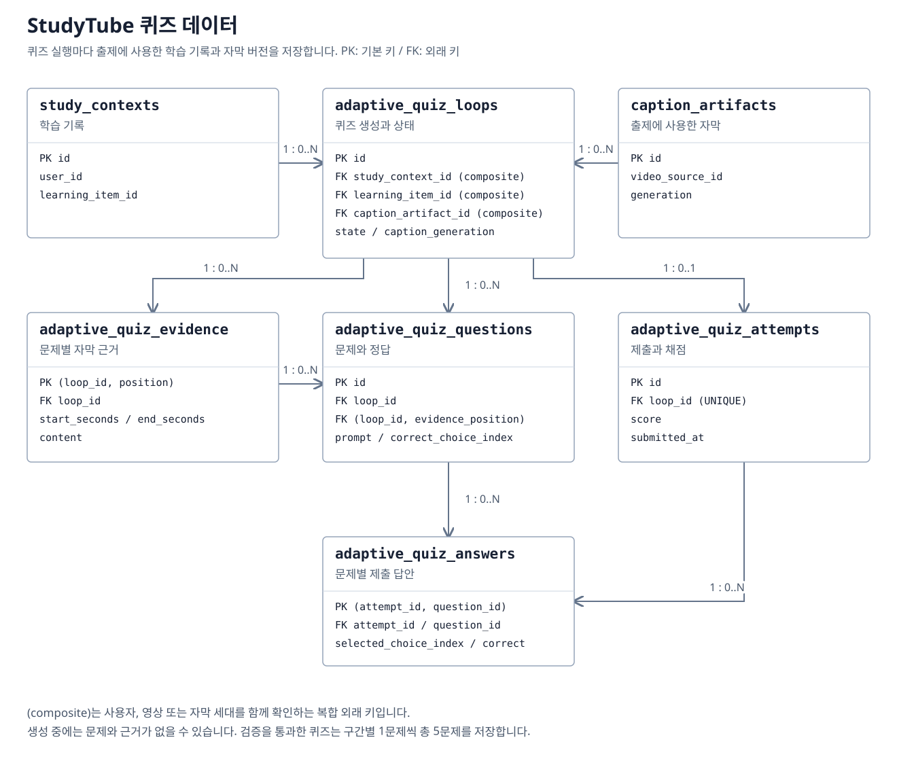

# StudyTube 아키텍처

StudyTube는 EC2 한 대에서 웹 서버와 API, Worker, AI 서버를 실행합니다. NestJS API가 사용자 데이터와 작업 기록을 저장하고 별도 Worker가 자막과 퀴즈 생성 같은 긴 작업을 처리합니다.

## 실행 구조

Caddy가 외부 HTTPS 요청을 받고 빌드된 React 정적 파일을 제공합니다. React 코드는 브라우저에서 실행됩니다. `/api` 요청은 Caddy가 NestJS API로 전달합니다.

API와 AI는 loopback 또는 Unix socket으로 통신합니다. DB와 큐도 외부 포트를 열지 않습니다. PostgreSQL에는 학습 데이터와 작업 상태를 저장하고 Valkey의 BullMQ 큐가 Worker에 작업을 전달합니다. Outbox Relay는 API 안에서 실행하는 서비스 클래스입니다.

| 실행 단위 | 역할 |
| --- | --- |
| 브라우저 | React 화면과 YouTube 플레이어 실행 |
| Caddy | HTTPS 처리와 정적 파일 제공, API 요청 전달 |
| NestJS API | 인증과 학습 데이터 관리, Outbox Relay 실행 |
| NestJS Worker | 큐에서 작업을 가져와 자막과 퀴즈 처리 |
| FastAPI | 자막 처리와 LangGraph 실행, MCP 도구 제공 |
| PostgreSQL | 학습 데이터와 작업 기록, pgvector 검색 벡터 저장 |
| Valkey | BullMQ 작업 대기열 |

Public Subnet의 t3.micro 한 대를 사용하며 메모리 부족에 대비해 2GB 스왑을 설정했습니다. GitHub Actions는 OIDC 임시 권한으로 S3에 배포 파일을 올립니다. Systems Manager가 EC2에서 배포 명령을 실행하고 CloudWatch에 배포 로그를 남깁니다.

## 영상 등록과 자막 처리

| 순서 | 담당 | 처리 내용 |
| ---: | --- | --- |
| 1 | Web | YouTube 주소와 학습 시간을 API에 보냅니다. |
| 2 | API | 학습 항목과 학습 기록, 보낼 작업을 같은 트랜잭션에 저장합니다. |
| 3 | API | 작업 ID를 돌려주고 학습 화면을 먼저 엽니다. |
| 4 | Outbox Relay | 저장된 작업 기록을 읽어 Valkey의 BullMQ 대기열로 보냅니다. |
| 5 | Worker와 FastAPI | 자막, 번역과 검색 자료를 준비합니다. |
| 6 | Web | 상태를 조회하며 준비된 원문과 번역부터 화면에 붙입니다. |

사용자는 작업 전체가 끝날 때까지 기다리지 않습니다. API가 학습 맥락을 만든 뒤 바로 화면을 열고 Web은 자막 상태를 조회하며 준비된 문장부터 보여 줍니다.

## Web 구성

| 시작점 | 연결하는 코드 | 역할 |
| --- | --- | --- |
| `AppRoutes` | `LearningPage`, `LearningWorkspace` | 입력 화면과 실제 학습 화면의 경로를 나눕니다. |
| `LearningPage` | `LearningIntakeForm` | 영상 주소와 학습 시간을 받습니다. |
| `LearningWorkspace` | `LearningVideoPlayer`, `CurrentSentencePanel` | 재생 시점과 현재 원문 및 번역을 맞춥니다. |
| `LearningWorkspace` | `LearningNotesPanel`, `AdaptiveQuizPanel` | 메모와 퀴즈를 현재 학습 맥락에 연결합니다. |
| `LearningWorkspace` | `CourseNavigator` | 저장한 코스의 이전과 다음 영상을 이동합니다. |
| hooks | `useLearningSession`, `useAdaptiveQuiz`, `useNextLearningProposal` | API 상태와 화면 동작을 분리합니다. |

`LearningWorkspace`가 영상과 네 가지 학습 도구를 조합합니다. 재생 위치와 현재 탭은 사용자별 브라우저 저장소에 남기고 코스, 메모, 자막과 퀴즈는 API를 통해 PostgreSQL에 저장합니다.

자막 설정은 `captionPreferences.ts`가 관리합니다. 표시 여부, 세 단계 크기와 0~100% 배경 진하기를 저장하며 YouTube 조작 버튼을 가리지 않도록 재생 상태에 따라 위치를 조정합니다.

## API 구성

| 요청 영역 | Controller | Service | Repository |
| --- | --- | --- | --- |
| 영상 등록과 자막 상태 | `LearningItemController` | `LearningItemService` | `LearningItemRepository`, `ProviderBudgetRepository` |
| 메모, 진도와 퀴즈 | `LearningController` | `LearningService` | `LearningRepository`, `LearningProposalRepository`, `RetrievalRepository` |
| 코스 저장과 순서 | `CourseController` | `CourseService` | `CourseRepository` |

Controller는 요청 형식과 로그인 상태를 확인하고 Service는 소유권과 변경 규칙을 처리합니다. Repository가 SQL을 맡기 때문에 화면과 Controller에는 테이블 구조가 드러나지 않습니다.

코스를 수정하거나 보관함에서 지울 때는 화면에 표시된 버전을 함께 보냅니다. API는 현재 버전과 다르면 변경을 거절해 다른 기기에서 수정한 내용을 이전 상태로 덮어쓰지 않게 합니다.

## 데이터 모델

`video_sources`는 영상 한 개를 식별합니다. 같은 영상을 여러 사용자가 등록하면 사용자마다 `learning_items`를 만듭니다. 같은 사용자가 같은 영상을 다시 등록할 때는 기존 항목을 사용합니다.

`study_contexts`는 단독 학습과 코스 학습을 구분합니다. 단독 학습은 학습 항목당 하나만 만들 수 있습니다. 코스 학습은 사용자와 코스 단계 조합당 하나입니다. 코스 단계가 삭제돼도 학습 기록의 출처를 남기기 위해 `course_step_provenance_id`를 별도로 저장합니다.

| 관계 | DB 제약 |
| --- | --- |
| 사용자 → 학습 항목 | `learning_items.user_id` 외래 키. 사용자와 영상 조합은 중복 불가 |
| 영상 → 학습 항목 | `learning_items.video_source_id` 외래 키 |
| 사용자 → 코스 | `courses.owner_id` 외래 키 |
| 코스 → 단계 | `course_steps.course_id` 외래 키. 코스 안의 position은 중복 불가 |
| 단계 → 영상 | `course_steps.video_source_id` 외래 키. null 허용 |
| 학습 항목 → 학습 기록 | `(learning_item_id, user_id)` 복합 외래 키로 소유자 일치 확인 |
| 코스 단계 → 학습 기록 | `study_contexts.course_step_id` 외래 키. 단독 학습에서는 null |
| 학습 기록 → 메모 | `(study_context_id, user_id)` 복합 외래 키 |
| 코스 단계 → 진도 | 사용자와 단계 조합으로 한 행 저장. `study_context_id`는 null 허용 |
| 영상 → 자막 | 영상과 종류, 생성 회차 조합은 중복 불가 |

진도 테이블의 고유 키는 `(user_id, course_step_id)`입니다. `study_context_id`만으로 진도와 학습 기록이 일대일이라고 볼 수 없습니다.

자막 원문과 번역은 `caption_artifacts`에 서로 다른 종류로 저장합니다. 번역과 검색용 자막은 `parent_artifact_id`로 원본을 참조합니다. 자막 문장은 `caption_artifact_segments`에 저장합니다. 학습 기록에는 현재 사용하는 원문과 번역, 검색용 자막 ID가 있습니다. 그림에는 주요 외래 키만 표시했습니다.

### 퀴즈 데이터

`adaptive_quiz`라는 단일 테이블은 없습니다. 생성 실행은 `adaptive_quiz_loops`, 문제별 근거는 `adaptive_quiz_evidence`, 문제는 `adaptive_quiz_questions`에 저장합니다.

- 실행마다 학습 기록과 영상, 출제 자막의 생성 회차를 복합 외래 키로 확인합니다.
- 문제는 `(loop_id, evidence_position)`으로 자막 근거를 참조합니다. DB는 같은 근거를 여러 문제가 참조하는 것을 허용합니다.
- `adaptive_quiz_attempts.loop_id`는 고유 값이므로 한 실행에 제출 기록을 하나만 저장합니다.
- 문제별 답안은 `adaptive_quiz_answers`에 저장합니다. 기본 키는 `(attempt_id, question_id)`입니다.
- 복습 제안은 `adaptive_quiz_review_proposals`에 저장합니다. 실행과 제출 기록 각각에 하나만 연결할 수 있습니다.

관계의 근거는 [영상과 학습 기록](../api/migrations/1753660813000_video-sources-and-learning-items.cjs), [자막](../api/migrations/1753660815000_learning-caption-artifacts.cjs), [퀴즈](../api/migrations/1753660817000_adaptive-learning-loop.cjs) 마이그레이션입니다.

## 작업 저장과 재시도

| 단계 | 클래스 | 책임 |
| ---: | --- | --- |
| 1 | `OutboxRelayService` | PostgreSQL에서 아직 보내지 않은 작업 기록을 가져옵니다. |
| 2 | `WorkQueuePublisher` | 같은 event ID로 BullMQ 작업을 발행합니다. |
| 3 | `BullMqVideoAssetWorker` | 대기열의 작업을 `DurableWorkRouter`에 넘깁니다. |
| 4 | `DurableWorkRouter` | 자막, 임베딩, 퀴즈와 내용 정리에 맞는 처리 함수를 고릅니다. |
| 5 | `DurableJobExecutor` | 작업 점유권과 진행 신호, 완료 결과를 `JobExecutionStore`에서 관리합니다. |

API는 데이터 변경과 보낼 작업을 같은 PostgreSQL 트랜잭션에 기록합니다. `OutboxRelayService`가 아직 보내지 않은 기록을 읽어 BullMQ에 넣으므로 DB 저장 뒤 프로세스가 멈춰도 작업이 남습니다.

`DurableJobExecutor`는 일정 시간 동안 작업을 맡을 권한을 얻고 실행 중에는 진행 신호를 갱신합니다. 이 권한을 잃으면 현재 작업을 중단합니다. 완료한 작업이 다시 들어오면 저장된 결과를 돌려줍니다.

## 퀴즈 생성과 검증

| 검사 | 통과 조건 |
| --- | --- |
| 자막 범위 | 시작 5초 안에서 시작하고 영상 끝부분까지 이어집니다. |
| 출제 구간 | 전체 시간을 다섯 구간으로 나눠 각 구간에서 문제에 쓸 문장을 고릅니다. |
| 문제 형식 | 보기 수, 정답 위치와 설명 형식을 검사합니다. |
| 내용 확인 | 보기와 정답이 선택한 자막 내용에서 벗어나지 않는지 검사합니다. |
| 저장 | 문제와 함께 자막 세대, 출제 시점과 영상 주소를 남깁니다. |

Web과 API가 영상 길이와 자막 범위를 각각 확인합니다. 시작 5초 안에서 자막이 시작하고 영상 끝부분까지 이어져야 퀴즈를 요청할 수 있습니다.

API는 전체 자막을 시간순 다섯 구간으로 나눠 문제에 쓸 문장을 고릅니다. FastAPI의 `quiz_generation_graph.py`는 문제 초안을 만든 뒤 형식과 정답이 자막 내용에 맞는지 검사하고 통과한 문제만 저장합니다.

## 코스 추천과 승인

| 순서 | 처리 |
| ---: | --- |
| 1 | 학습 목표와 시간으로 YouTube 후보를 찾습니다. |
| 2 | 최근 본 영상, 저장한 코스의 영상과 재생할 수 없는 영상을 뺍니다. |
| 3 | 주제, 자막, 난이도, 길이와 실습 여부로 점수를 매깁니다. |
| 4 | 입문, 개념, 실습과 활용 순서로 브라우저 초안을 만듭니다. |
| 5 | 사용자가 저장할 때만 API에 코스를 만듭니다. |

`video_recommendation.py`는 재생할 수 없는 영상, 최근 본 영상, 저장한 코스의 영상과 주제 관련도가 낮은 영상을 먼저 제외합니다. 남은 후보는 자막, 최근 학습, 난이도, 길이와 실습 여부를 기준으로 정렬합니다.

추천 결과는 브라우저 초안입니다. 사용자가 저장을 누른 뒤에만 API가 코스를 만들고 저장을 완료합니다. 퀴즈 뒤 제안되는 다음 영상도 기존 코스 또는 새 비공개 코스를 선택해 승인해야 반영됩니다.

## 인증과 계정 데이터

운영 환경은 Google 로그인을 사용합니다. 인증 자격 증명은 HttpOnly 세션 쿠키에만 두고 Web은 화면 표시용 사용자 정보와 학습 설정을 localStorage에 저장합니다. API는 Origin과 요청 형식을 다시 확인합니다.

계정을 삭제할 때는 같은 Google 계정으로 다시 본인 확인을 거칩니다. API는 최근 본인 확인이 남아 있는지 검사하고 사용자와 학습 데이터를 하나의 PostgreSQL 트랜잭션에서 지운 뒤 세션 쿠키를 만료합니다.

## 배포

| 단계 | 배포 경계 |
| ---: | --- |
| 1 | `main`의 Security, Web, API, AI와 Integration 검사를 모두 통과합니다. |
| 2 | 같은 커밋으로 배포 파일과 SHA-256 체크섬을 만듭니다. |
| 3 | GitHub OIDC 임시 권한으로 S3 Object Lock에 올립니다. |
| 4 | SSM이 EC2에서 체크섬과 관리자 소유 설정을 다시 확인합니다. |
| 5 | API, AI, Worker, PostgreSQL, Valkey와 공개 Web이 모두 준비된 뒤 배포를 전환합니다. |

CI가 확인한 커밋만 배포 파일로 만듭니다. GitHub Actions는 OIDC 임시 권한으로 S3에 올리고 SSM이 EC2에서 체크섬과 구성 파일을 다시 확인한 뒤 서비스를 전환합니다.

자세한 배포와 복구 순서는 [CI/CD 문서](ci-cd.md), 운영 점검은 [Operations README](../operations/README.md)에 있습니다.

## 관련 코드

1. [LearningWorkspace.tsx](../web/src/features/learning/LearningWorkspace.tsx)
2. [captionState.ts](../web/src/features/learning/captionState.ts)
3. [CoursePage.tsx](../web/src/features/course/CoursePage.tsx)
4. [learning-item.service.ts](../api/src/learning/learning-item.service.ts)
5. [postgres-quiz.repository.ts](../api/src/learning/postgres-quiz.repository.ts)
6. [outbox-relay.service.ts](../api/src/work/outbox-relay.service.ts)
7. [durable-job.executor.ts](../api/src/work/durable-job.executor.ts)
8. [quiz_generation_graph.py](../ai/quiz_generation_graph.py)
9. [video_recommendation.py](../ai/video_recommendation.py)
